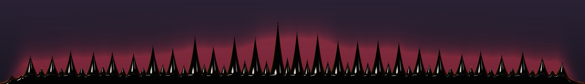
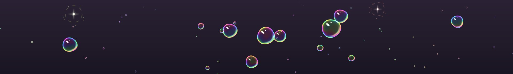

<p align="center">
  
</p>

<h1 align="center">Iron Will</h1>

<p align="center">
  <b>A lightweight desktop audio toolkit for KDE Plasma 6</b><br>
  Session sounds on login, resume and unlock, plus a click-through audio visualizer that lives on your desktop.
</p>

<p align="center">
  
  
  
  
  
</p>

<p align="center">
  
</p>

<p align="center">
   <b><a href="docs/OVERVIEW.md">Read the full overview</a></b>: every mode in depth, all settings, and how it works under the hood.
</p>

## What it does

-  **Session sounds:** plays a random track from your music folder when you log in, wake your laptop, or unlock the screen.
-  **Desktop visualizer:** music bars that sit on your desktop, right above the panel. They never get in the way of your windows or your clicks.
-  **Six styles:** bars, wave, mirror, fire, ferrofluid and bubbles.
-  **Genre presets:** one click tunes the motion for metal, phonk, electronic, hip-hop, calm music and more.
-  **Stays out of the way:** the visualizer fades out when the music stops, waits behind the lock screen, and pauses while a fullscreen game, a video or a maximized window covers it.
-  **Settings app:** change anything with sliders and switches, and watch the visualizer update live.

## On the desktop

<p align="center">
  
</p>

| Bars | Wave | Mirror |
|---|---|---|
|  |  |  |
| **Fire** | **Ferrofluid** | **Bubbles** |
|  |  |  |

## Install

You need **KDE Plasma 6** on Linux (Wayland recommended).

```bash
git clone https://github.com/DarkCodeGD/iron-will.git
cd iron-will
./install.sh
```

The installer checks what's missing and asks before installing anything with `sudo`. Everything else stays in your home folder. To see what it would do first, run `./install.sh --dry-run`.

To uninstall, run `./uninstall.sh`. Add `--purge` to also remove your settings. Your music is never touched.

## How to use it

1. Open **Iron Will** from your app menu.
2. Point **Session Sounds** at a folder of music, or keep the chime that comes with it.
3. Pick a style and a genre preset on the **Appearance** and **Motion** pages. Changes save automatically.

**Want a sound to stop?** Press **Stop** on its notification, use Plasma's media controls, or just start your own music.

## Need help?

- **No bars?** Open the **System** page in the settings app: it checks that everything Iron Will needs is installed.
- **Hearing two login sounds?** Turn off Plasma's own login sound in System Settings → Notifications → Plasma Workspace.
- **More fixes, all settings, and how it all works:** see the **[full overview](docs/OVERVIEW.md)**.
