<p align="center">
  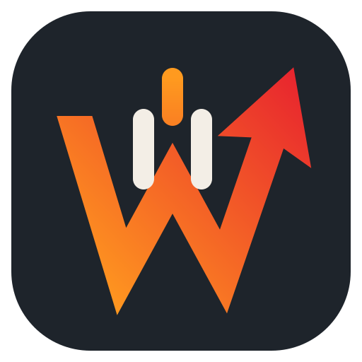
</p>

<h1 align="center">Iron Will</h1>

<p align="center">
  <b>A lightweight desktop audio toolkit for KDE Plasma 6</b><br>
  Session sounds on login, resume and unlock, plus a click-through audio visualizer that lives on your desktop.
</p>

<p align="center">
  
  
  
  
  
</p>

<p align="center">
  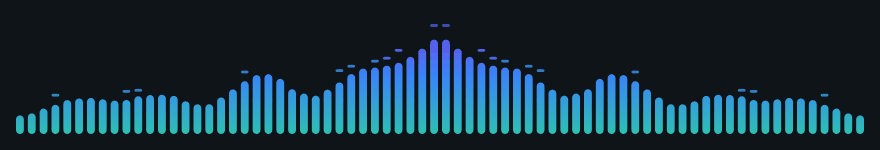
</p>

- **Session sounds:** plays a random track from your library on **login**, **resume from suspend**, and **screen unlock**. A notification with a **Stop** button shows while it plays.
- **Waits for your password:** after waking up behind the lock screen, both the sound and the visualizer wait until you've unlocked, then start together.
- **Desktop visualizer:** a click-through spectrum visualizer on the desktop layer, sitting right above your panel. It never steals focus and never covers windows.
- **Genre presets:** one tap retunes the bounce physics and frequency range for metal, phonk, electronic, hip-hop, calm and more.
- **Settings app:** a GUI for every setting. Changes auto-save, and the visualizer **updates live** as you drag sliders.

## On the desktop

<p align="center">
  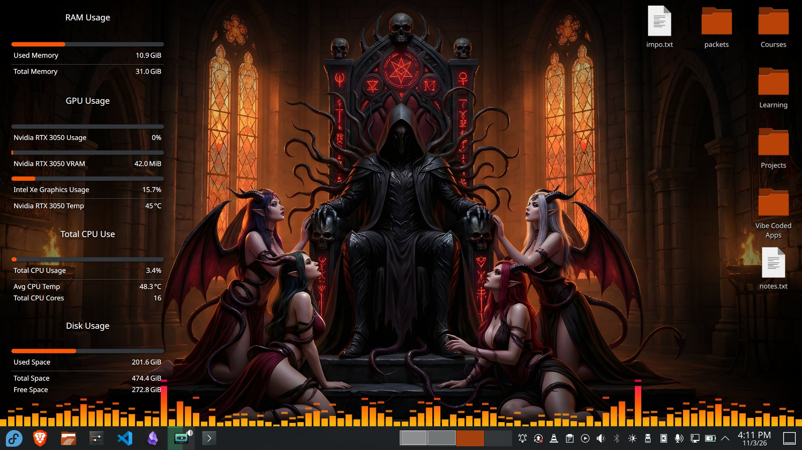
</p>

Four render modes, all anchored right above the Plasma panel and click-through:

| | |
|---|---|
| **Bars** · pill-shaped, following the Plasma accent color | 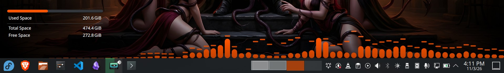 |
| **Wave** · smooth curve with a custom gradient | 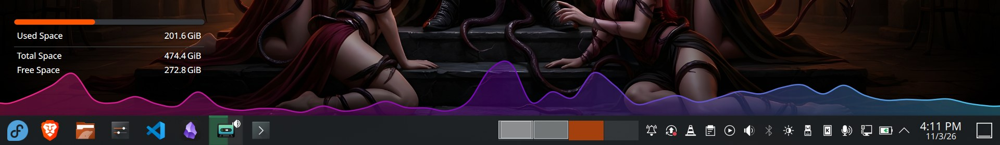 |
| **Mirror** · bass in the middle, with falling peak caps | 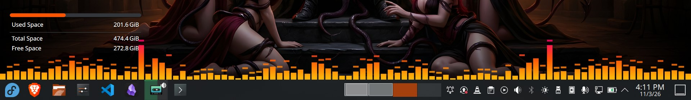 |
| **Fire** · GPU flames that surge on every kick (see [Fire mode](#fire-mode)) | 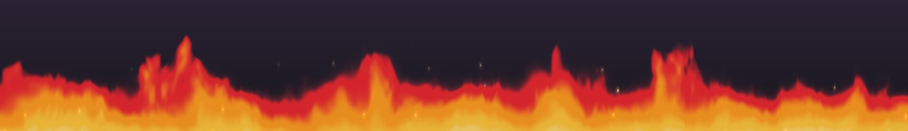 |

## Fire mode

Stylized flames drawn by a GPU shader, built for rock and metal. The music never sets the flame height directly. It feeds a small combustion model, so every reaction catches, flares and dies down like real fire instead of snapping to the beat:

1. **A hit throws fuel on the fire.** Kicks add a lot, snares and cymbals a little.
2. **It ignites:** a flash of heat at the base about 100 ms later, so brightness leads.
3. **Whoomph:** the flames shoot up on a damped spring (peak around 300 ms, with a touch of overshoot), while a band of heat rises through the tongues.
4. **It spreads** sideways to neighbouring flames, like fire catching along a log, then **burns down** over about a second.

| In the mix | In the fire |
|---|---|
| **Kick drum, bass** | ignitions: heat flashes and flare-ups. Non-stop double bass builds a big, roaring fire that still breathes instead of jittering |
| **Rhythm guitars, vocals** | the flame *bed*: the steady body of the fire |
| **Snare, cymbals** | a little fuel, and *sparks*: a crash throws a shower of embers |
| **Every ignition** | a burst of embers that rise well above the flames, cooling from gold to the tip color |
| **Overall heat** | *speed*: calm parts lick lazily, a hot fire churns hard |

Metal is mastered loud, so the level barely moves and a fire that followed plain loudness would sit at full height. Instead, each detector tracks how far its part of the spectrum jumps above its own recent average, scaled against the biggest recent hit. A kick still lands on top of a wall of guitars.

Fire has its own dynamics: the Motion page's attack and decay shape the bars, not the flames. Use **Reaction** in the Fire card instead, from *Slow burn* to *Explosive*.

- **Glow:** the fire throws light onto the wallpaper around it, brightest in the gaps between tongues and fading to wine-red higher up, flickering like firelight on a wall. The hottest spots bloom toward white. The **Glow** slider sets how much.
- **Blending:** fire is light, not paint. The flames *add* their glow to your wallpaper and only partly hide it: wispy tips are see-through, the hot core is nearly solid. The **Translucency** slider goes from solid stylized flames to ghostly; lower it on bright wallpapers, where translucent flames wash out like fire in daylight.
- **Colors:** *Your colors* uses your gradient (first stop at the base, last at the tips, so the **Ascend** preset gives orange→crimson fire and a cool gradient gives blue fire). *Natural fire* ignores your colors.
- **Embers:** two layers (big, fast ones up front and small, slow ones behind, for depth) that sway in the updraft and twinkle. Each one is a solid orange-gold speck with a white-hot center, so it reads on dark and bright wallpapers alike and over the fire's own glow. A burning fire always sheds some; hits throw showers. They need open sky: if your flames fill the window, turn on Full screen height. The **Sparks** slider sets how many.
- **Height:** fire needs room. It comes alive at 220–300 px, and the Fire card offers a one-click resize when your visualizer is shorter. Tongues that reach the top of the window fade out instead of being cut off. For real headroom, turn on **Full screen height** (Layout page, or `full_height` in `[layout]`): the window spans the whole screen and the fire keeps its size (Flame height is rescaled for you), so tall licks, glow and embers have open sky. The window stays click-through, and the sky above the fire is cheap: the shader skips its turbulence there.
- **Cost:** about 8% of one CPU core in testing (bars: ~46% at the same size), because the GPU draws every pixel. Like the other modes, it stops completely after the idle fade.
- **No GPU?** On a software-rendered desktop, fire mode falls back to bars.

## Genre presets

Different music needs different physics. Fast double-bass drumming needs bars that fall quickly so each hit stays visible. A phonk 808 should boom and hang. Ambient music should float. Pick a preset on the **Motion** page; it changes only the *feel* (attack, decay, peaks and analysed frequency range), never your colors or layout. Change any slider afterwards and the preset shows as **Custom**. The live preview plays a matching demo groove for each preset.

| Preset | Attack / Decay | Frequency range | Tuned for |
|---|---|---|---|
| **Balanced** | 35 / 220 ms | 50 Hz – 12 kHz | any playlist |
| **Metal & Rock** | 8 / 110 ms | 40 Hz – 16 kHz | fast drums, double bass, cymbals and riffs |
| **Phonk & Bass** | 15 / 320 ms | 25 Hz – 6 kHz | heavy, sustained 808s, with extra bars for the low end |
| **Electronic** | 18 / 200 ms | 35 Hz – 14 kHz | four-on-the-floor kicks and crisp hi-hats |
| **Hip-Hop & R&B** | 25 / 260 ms | 30 Hz – 9 kHz | kick and snare, sub-bass, vocal mids |
| **Calm & Ambient** | 90 / 650 ms | 50 Hz – 10 kHz | lo-fi, ambient, classical |
| **Jazz & Acoustic** | 40 / 380 ms | 60 Hz – 14 kHz | natural instruments, soft dynamics |

Presets live in [`iron_will/presets.py`](iron_will/presets.py). Each one is a single line of values, so adding your own genre is easy.

## Stopping a sound

Not in the mood for the full track? Any of these stops it, no matter which part of Iron Will started it:

| Where | How |
|---|---|
| **Notification** | Press **Stop** on the "Login / Resume / Unlock sound" popup (toggle it under *Session Sounds → Playback*) |
| **Settings app** | The *Play random track* button turns into **Stop** while anything is playing |
| **App menu** | Right-click *Iron Will* → **Stop session sound** |
| **Keyboard shortcut** | System Settings → Keyboard → Shortcuts → *Add New* → *Application* → Iron Will, then bind *Stop session sound* |
| **Terminal** | `iron-will-audio --stop` |

Going to sleep also stops the sound, so a track never freezes mid-song and plays on after you wake up.

## Waking up

Plasma locks the screen when the laptop goes to sleep, so the moment you're *really* back is when you type your password, not when the lid opens. Iron Will treats it that way:

1. **Lid opens → lock screen.** Silence. The visualizer stays hidden and cava is stopped, so nothing runs behind the lock screen.
2. **Password entered.** Within about half a second, the **resume sound** plays (just one sound, not resume plus unlock) and the bars fade in.

Without a lock screen, the resume sound plays after *Resume delay* as usual. A plain lock and unlock (Meta+L) works the same way: the visualizer pauses while locked, and the *Screen unlock* sound plays when you're back.

## Settings app

Flat, pill-shaped controls in a dark slate theme with the logo's fire palette: orange for the visualizer, crimson-rose for session sounds, mint for "all good". Soft tints lean toward wine instead of fading orange into brown. The live preview uses the same renderer as the desktop.

<table>
  <tr>
    <td width="50%">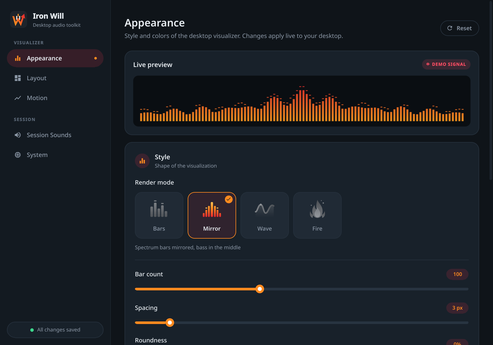<br><sub><b>Appearance:</b> render mode tiles, bar shape, fire, colors and presets, with a live preview</sub></td>
    <td width="50%">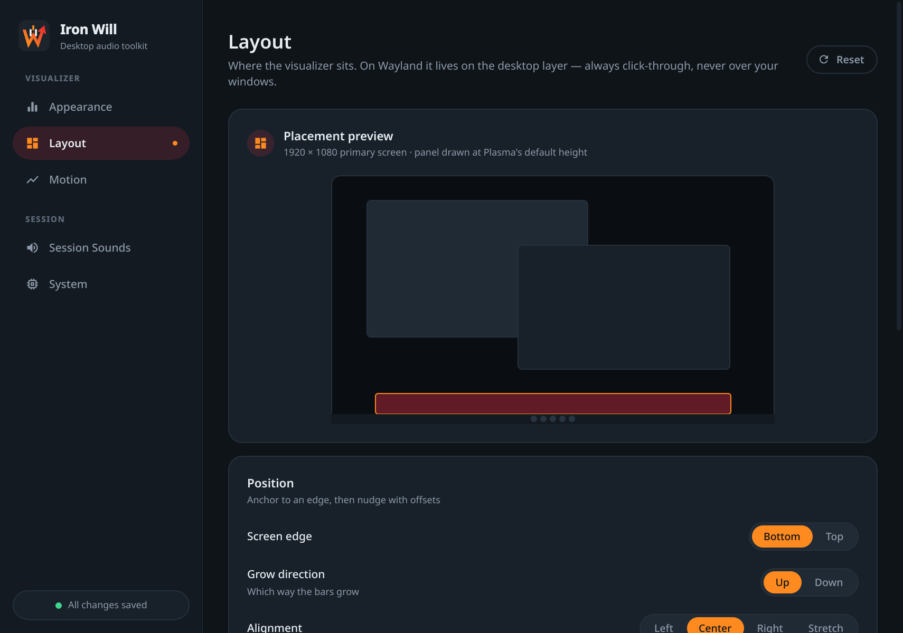<br><sub><b>Layout:</b> a placement diagram plus edge, grow direction, alignment, size (or full screen height), offsets and layer</sub></td>
  </tr>
  <tr>
    <td>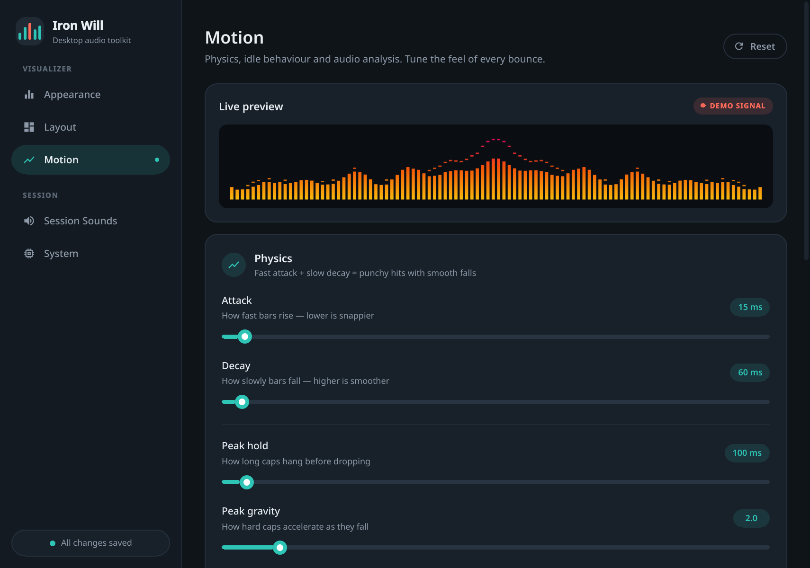<br><sub><b>Motion:</b> genre presets, attack/decay physics, peak gravity, idle fade, cava analysis</sub></td>
    <td>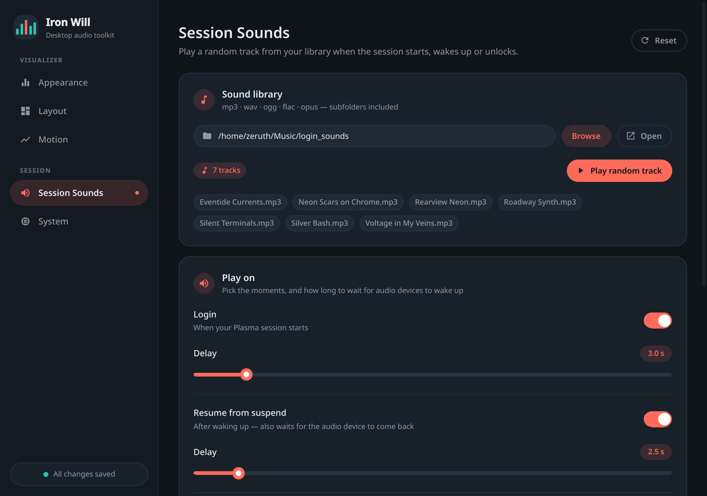<br><sub><b>Session Sounds:</b> library, trigger events with delays, volume, cooldown</sub></td>
  </tr>
  <tr>
    <td colspan="2">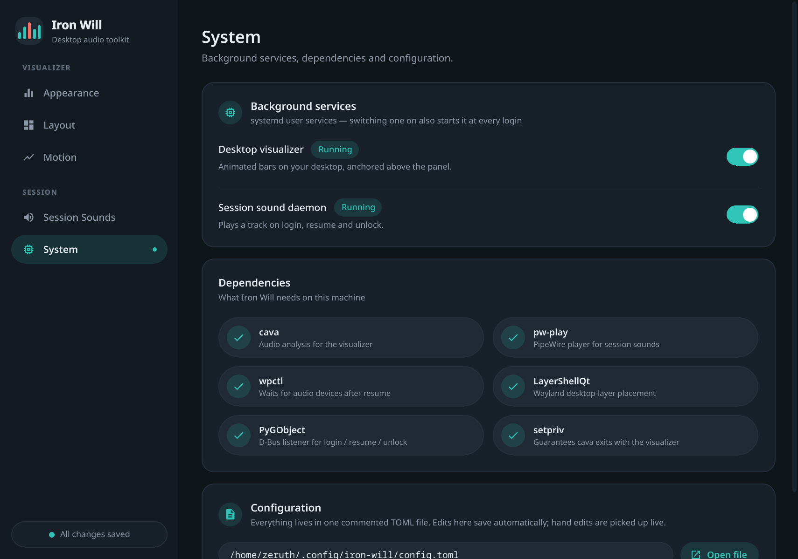<br><sub><b>System:</b> background service toggles, a live dependency check, and the config file</sub></td>
  </tr>
</table>

## Install

```bash
./install.sh --dry-run   # preview every step
./install.sh             # install (asks before using sudo for missing packages)
```

Everything goes into your home directory: `~/.local/share/iron-will`, `~/.local/bin`, `~/.config/iron-will`, and systemd **user** units. Root is only used, after asking, to install packages. If your sound folder is empty, the installer generates a soft chime so it works right away.

Uninstall with `./uninstall.sh` (keeps config) or `./uninstall.sh --purge`. Your sound folder is never touched.

### Dependency checklist

| Need | Fedora | Arch | Used for |
|---|---|---|---|
| Python ≥ 3.11 | `python3` | `python` | everything (`tomllib`) |
| PySide6 | `python3-pyside6` | `pyside6` | visualizer + settings GUI |
| LayerShellQt | `layer-shell-qt` | `layer-shell-qt` | Wayland desktop-layer placement |
| cava | `cava` | `cava` | real-time frequency analysis |
| pw-play | `pipewire-utils` | `pipewire` | session sound playback |
| wpctl | `wireplumber` | `wireplumber` | waiting for audio devices after resume |
| PyGObject | `python3-gobject` | `python-gobject` | D-Bus listener |
| setpriv *(optional)* | `util-linux` | `util-linux` | makes sure cava dies with the visualizer |
| paplay / ffplay / mpv *(optional)* | | | playback fallbacks |

The **System** page in the settings app shows this checklist live.

## Usage

| Command | What it does |
|---|---|
| `iron-will-settings` | open the settings app (also in the app menu as *Iron Will*) |
| `iron-will-audio --play` | play one random track now |
| `iron-will-audio --list` | list the tracks the daemon would use |
| `iron-will-audio --stop` | stop the sound that's playing (from any source) |
| `iron-will-audio --status` | show what's playing (exit code 1 if nothing) |
| `systemctl --user restart iron-will-visualizer` | restart the visualizer |
| `journalctl --user -u iron-will-visualizer -u iron-will-audio -f` | follow the logs |

Set `IRON_WILL_DEBUG=1` for verbose logs.

## Configuration

Everything is stored in one commented file, `~/.config/iron-will/config.toml` (see [`config/config.example.toml`](config/config.example.toml)). You can edit it by hand or in the GUI. Both components pick up changes live. Invalid values fall back to their defaults and never crash anything.

Main groups: `[visualizer]` (mode, bars, spacing, roundness, colors, opacity, fps), `[motion]` (attack/decay, peak physics, idle fade), `[layout]` (edge, grow direction, alignment, size or full screen height, offsets, layer), `[analysis]` (cava sensitivity, frequency range) and `[sounds]` (folder, events, delays, cooldown, volume, player).

## Architecture

```
                       ┌──────────── ~/.config/iron-will/config.toml ────────────┐
                       │      (one schema: iron_will/config.py → FIELDS)          │
                       ▼                         ▲ autosave            ▼ re-read per event
 ┌──────── visualizer ─────────┐    ┌──── settings GUI ────┐    ┌──── dispatcher ────┐
 │ ConfigStore (file watcher)  │    │ ConfigStore+autosave │    │ GLib main loop     │
 │   ├─ LayoutModel ─▶ layer-  │    │ SettingsBackend ─▶QML│    │ logind PrepareFor- │
 │   │    shell anchors/margins│    │ live preview uses the│    │   Sleep → resume   │
 │   └─ VisualizerItem ◀─frame─┤    │ same VisualizerItem  │    │ ScreenSaver Active-│
 │ CavaProcess (stdout pipe)   │    │ with a demo signal   │    │   Changed → unlock │
 │   └─ cava ◀── PipeWire      │    └──────────────────────┘    │ Player (flock,     │
 └─────────────────────────────┘                                │  backend fallback) │
                                                                └────────────────────┘
```

Key design decisions:

- **Layer-shell instead of window hints.** On Wayland, `WindowStaysOnBottomHint` and absolute positioning are ignored. A layer-shell surface on the *bottom* layer is placed by the compositor, the same way Plasma places panels. With `exclusionZone = 0` it automatically sits above the panel.
- **cava over a stdout pipe, not a FIFO.** No stale `/tmp` files and no blocking open handshake, and EOF tells us immediately if cava dies (it's restarted with backoff). cava runs under `setpriv --pdeathsig`, so even a SIGKILL'd visualizer can't leave an orphan.
- **Asymmetric EMA physics.** Bars rise with a short time constant and fall with a long one, using `alpha = 1 − e^(−dt/τ)`, so motion looks the same at any frame rate. Peak caps hang, then fall with gravity.
- **Zero cost when idle.** After the configured silence, the visualizer fades out and stops its render timer completely.
- **Survives suspend and hot-plug.** When an output disappears (suspend, lid close, unplugged monitor), the compositor closes the layer surface. Qt's default would then quit the app with a *clean* exit that `Restart=on-failure` ignores. Instead, a window guardian pauses rendering, and recovers in **one calm step** once the desktop has settled: it restarts cava (if we slept), then re-shows the bars with a fade-in, and moves them back to their home output when that returns. It detects the wake by watching `CLOCK_BOOTTIME − CLOCK_MONOTONIC` jump. Doing nothing for the first ~2.5 s after a wake matters, because that's when KWin, PipeWire and the network are all reconnecting at once.
- **The lock screen is the gate.** Both components watch `org.freedesktop.ScreenSaver`. After a resume, the daemon asks `GetActive()` instead of trusting signals sent around the suspend; if the screen is locked, the resume sound is held until the unlock. The visualizer's guardian treats "locked" as a hard stop: it pauses drawing, stops cava, and runs its recovery step only after the unlock.
- **A real lock → unlock, not any signal.** An unlock only counts after a lock was seen, only from the actual ScreenSaver owner, and never between `PrepareForSleep(true)` and `(false)`. The lock screen can flap while the machine goes down, and that used to start a sound that froze mid-suspend.
- **User daemon, not `system-sleep` hooks.** Root sleep hooks can't reach your PipeWire session. The daemon listens on D-Bus as you, uses `CLOCK_BOOTTIME` for the cooldown (time spent suspended counts), waits for an audio sink with `wpctl` after resume, and holds a kernel `flock` so sounds never overlap across processes.

## Project layout

```
iron_will/
  config.py  presets.py  paths.py  accent.py  util.py  qtcommon.py
  dispatcher/   player.py  daemon.py  notify.py  chime.py
  visualizer/   modes.py  cava.py  physics.py  fire.py  demo.py  renderer.py  layout.py  guardian.py  lockwatch.py  app.py
                qml/{Visualizer.qml, WaylandWindow.qml, X11Window.qml}  shaders/{fire.frag, fire.frag.qsb, build.sh}
  settings/     backend.py  app.py  qml/{Main.qml, components/, pages/}
  assets/iron-will.svg  assets/modes/{bars, mirror, wave, fire}.svg
systemd/  desktop/  config/config.example.toml  install.sh  uninstall.sh
```

### Adding a visualizer

Render modes live in one registry, `iron_will/visualizer/modes.py`. Add a `RenderMode` (id, name, tagline, icon) and an SVG icon in `assets/modes/` (64×64 viewBox, plain paths and gradients, no filters), then give it a renderer. The config schema and the settings app's mode tiles pick it up from the registry.

## Troubleshooting

- **No bars?** Check `cava` is installed (System page), then look at `$XDG_RUNTIME_DIR/iron-will/cava.log`.
- **Fire mode shows bars?** The desktop is rendering in software (no GPU shaders). The visualizer log says *"no GPU shaders"*.
- **Visualizer is a normal window on Wayland?** The LayerShellQt QML module is missing. Install `layer-shell-qt`.
- **Two login sounds?** Turn off Plasma's own login sound in System Settings → Notifications → Plasma Workspace.
- **No sound after resume?** Raise *Resume delay* in Session Sounds. The daemon also waits up to 10 s for the audio device.
- **Visualizer missing after waking up?** Check `journalctl --user -u iron-will-visualizer -b`. You should see *"surface was closed … waiting for a screen"* followed by *"re-showing the visualizer"*.
